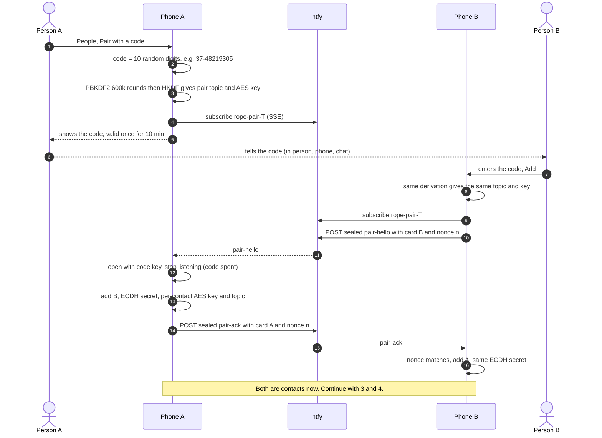
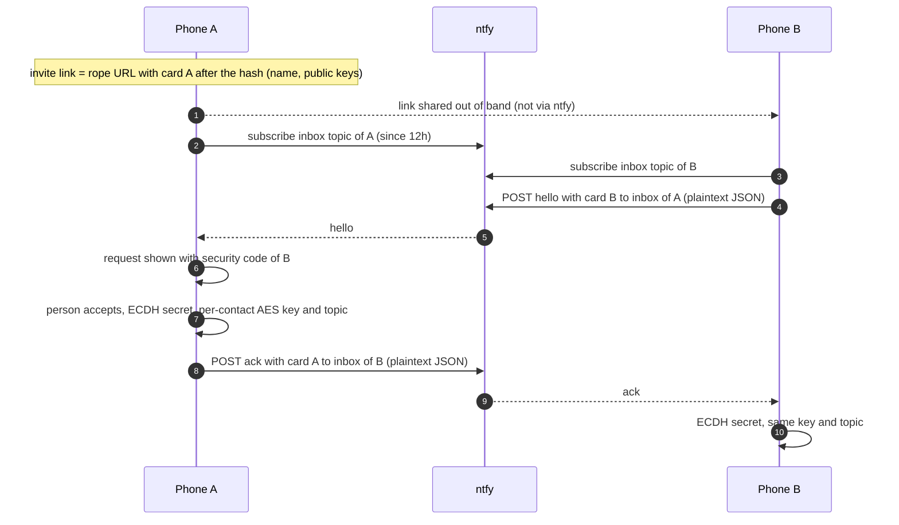
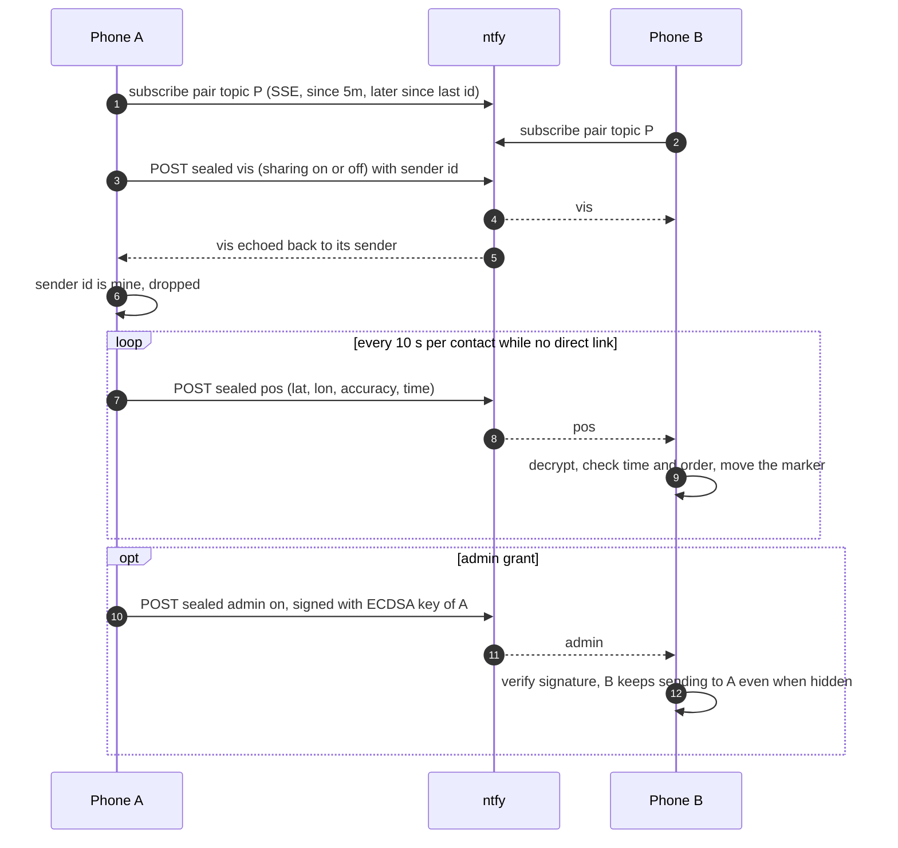
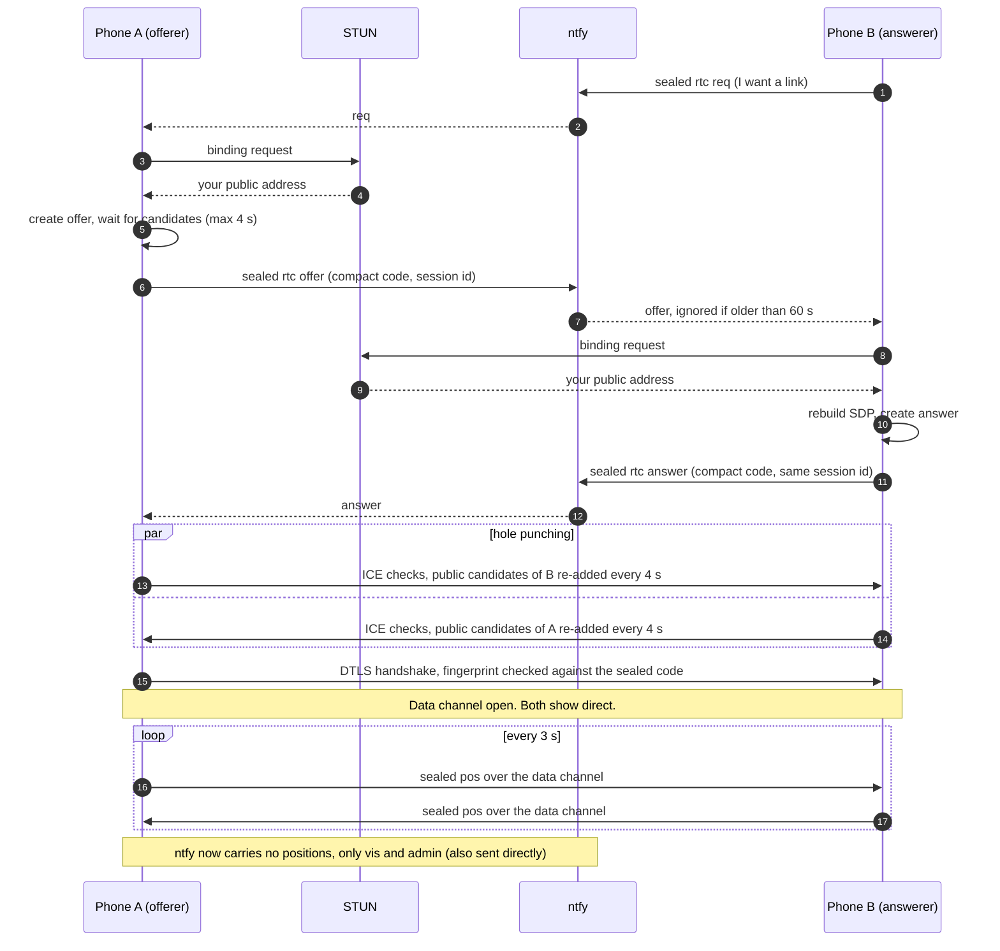
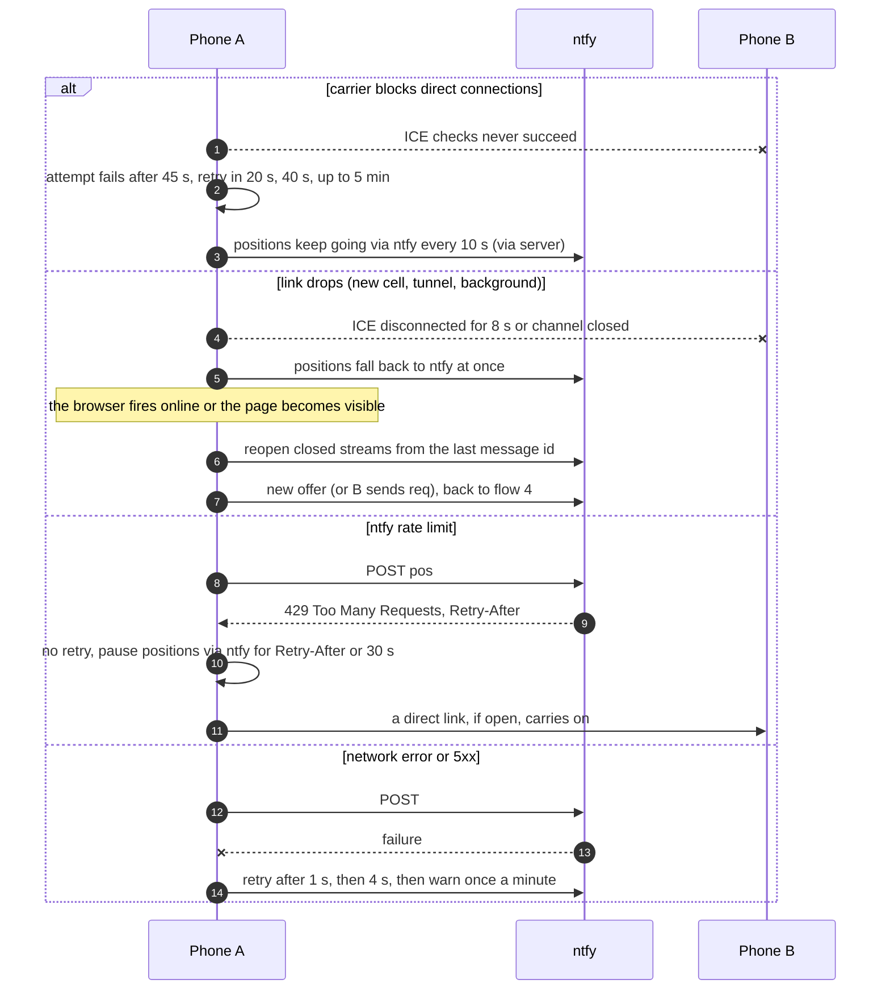

# Rope

A single-page web app with no backend of its own. It shows your GPS position on an
OpenStreetMap map, shares live positions with a circle of trusted people, shows the distance to
each of them in metres, adds terrain heights from hoydedata, and plans routes.

It is plain static files, so it runs on GitHub Pages.

```bash
npm start      # http://localhost:8080 (local static server)
npm test       # crypto, visibility/admin rules, distance
npm run build  # copies public/ to dist/
```

Browsers only give GPS and WebCrypto on `https://` or `localhost`.

## How people find each other without a backend

People can't connect directly without something to meet on. Rope uses a **rendezvous server**:
a public [ntfy](https://ntfy.sh) publish/subscribe relay (default `https://ntfy.sh`). It is not
ours and holds no accounts. It sees topic names and ciphertext only. You can point Rope at your
own ntfy server under **Me → Rendezvous server**. Everyone in a circle must use the same one.

1. **Identity.** On first run your browser creates two keys (ECDH for pairing, ECDSA for signing)
   and stores them in `localStorage`. Nothing is uploaded.

**Pairing with a code** (the simple way, after BeamBridge). One person taps **People → Pair with a
code** and gets a code like `37-48219305`; the other types it into the same field where links are
pasted and taps **Add**. Both are contacts straight away: knowing the code is the consent, so there
is no accept step. The code works **once**, for **10 minutes**.

- The code is the only secret. Both phones turn it into the same rendezvous topic and AES-GCM key
  with a deliberately slow derivation (PBKDF2-SHA-256, 600 000 rounds, then HKDF), and swap their
  contact cards (name and public keys) sealed with that key. Then pairing continues as in step 4.
- The person who enters the code sends a random nonce and only accepts the answer that quotes it,
  so an old answer for a spent code is never taken for a new one.
- Security, compared with BeamBridge: BeamBridge runs a PAKE (SPAKE2) over magic-wormhole, so a
  wrong guess burns the code and nobody can test codes offline. Browsers have no PAKE built in, so
  Rope relies on the code being unguessable for its 10 minutes: 10 digits (10^10 codes) times
  600 000 rounds each is far more than anyone can try in that time, the rendezvous server only sees
  a topic derived from the code, and once pairing is over nothing secret remains (the cards hold
  public keys only). Give the code only to the person you mean, over a channel you trust.

**Pairing with an invite link** (still there, under the code):
2. **Invite.** *Copy my invite link* gives a reusable link (`…#c=<card>`). The card holds your name
   and public keys. The part after `#` is never sent to a web server.
3. **Request.** The person who opens the link sends a request to your inbox topic on the
   rendezvous server. You see it with a security code and accept or decline.
4. **Per-contact secret.** On accept, both sides derive the same secret from their keys (ECDH).
   It gives each contact its own AES-GCM key and its own unguessable topic.
5. **Sharing.** Positions are encrypted and published to that contact's topic every 10 s.
   The rendezvous server only relays ciphertext.
6. **Direct link (peer to peer).** Each pair also tries to open a direct WebRTC data channel, after
   OneChat's serverless connect. The offer and answer are packed into compact codes (ICE ufrag and
   password, DTLS fingerprint, UDP candidates) and sent over the encrypted pair topic; the other side
   rebuilds the SDP from a template. A public STUN server (Google, Cloudflare) tells each phone its
   public address, and the peer's public candidates are re-added every few seconds so both NATs keep
   their hole open until the checks meet. The side with the lower id always offers, so the two never
   offer at once. Because the fingerprint arrives sealed with the contact's key, only that contact can
   complete the handshake.
   While the direct link is open, positions go straight between the phones every 3 s and the
   rendezvous server is not used for them (visibility and admin messages still go through it too,
   so a phone that is offline gets them later). If the link can't open (some mobile networks block
   direct connections and there is no TURN relay) or drops, positions fall back to the rendezvous
   server, and the link is retried with back-off (20 s doubling to 5 min), and at once when the
   network comes back or the app is reopened. Each contact shows **direct** or **via server**.
7. **Rate limits.** ntfy.sh limits requests per IP address, and mobile carriers often put many
   phones behind one address. A failed send is retried twice; a *429 Too Many Requests* is not
   retried, and position updates over the server pause for as long as it asks (`Retry-After`).
   Every pair message carries the sender's id, because the server echoes your own messages back
   on the shared topic.

## Following, trails and reload

- **Following:** the map opens following your own position. Two arrows sit at the bottom: the **left**
  one (your colour) follows you; the **right** one (the colour of the person) follows the person you chose
  with **Show**, and appears once you have chosen someone. An arrow is filled while it is following and
  outlined otherwise, and its glyph switches between white and black so it stays visible on any colour.
  Drag the map to stop following; each arrow then resumes its own target.
- **All:** the **All** entry in the top menu (next to Me) follows **you**, zoomed out just far enough that
  everyone you can see is in view, with you kept in the middle as you and they move. It also shows the
  trails of everyone who has one switched on. Dragging the map, or zooming it by hand, leaves All
  (zooming leaves you following yourself at the new zoom). Resizing the window or turning the phone keeps
  following whatever you were following.
- **Distances:** the measure-tape button (bottom right) toggles a live view of the direct distance from
  you to each person visible on the map: a dashed line in their colour with the distance at its middle,
  updating as either of you moves. It is **off by default** and the choice is remembered. Under 1 000 m
  it reads in whole metres (`850 m`); from 1 000 m it reads in kilometres (`1.25 km`, `12.3 km`, `152 km`).
  When a person is far away, the label sits on the part of the line that is on screen; if none of the
  line is on screen, the label is hidden.
- **Debug overlay:** tap **All** four times quickly (within 1.5 s) to show connection details over the
  map; four taps again, or ×, hide it. The choice is remembered on that device. It shows the build,
  network and GPS state; the rendezvous server (messages sent and failed, rate limits, each stream's
  state); per person the direct link (state, ICE, the route in use and its round-trip time, the next
  retry and the last error) and messages sent/received directly and via the server; and a log of
  recent events, warnings (yellow) and errors (red). **Copy** puts all of it on the clipboard, to
  paste into a bug report.
- **Scale:** a small scale line at the bottom left adapts as you zoom in and out.
- **Colour:** each person, you included, has one colour, used for their map marker, avatar, arrow and trail.
  Pick it from the palette (or leave it on Auto) in their card, or under Me for yourself. It is set
  independently of the trail switch.
- **Trails:** each person, you included, can have a trail of their last stretch of path, fading toward
  the oldest end. It is **off by default** and set per person: on/off, length (default 1 km)
  and the colour above. The **length** is chosen with two wheels, like an iOS picker: a number wheel and a unit wheel
  (**Metres, Kilometres, Miles**). Metres go from 50 to 950 in steps of 50, kilometres from 1 to 100 and miles
  from 1 to 60. A length is stored as you pick it, so 3 mi stays 3 mi. Turning the unit keeps the length as
  close as the new unit allows. The wheels curve away from the highlighted band (rows shrink, bunch together
  and fade), always come to rest exactly on a row, and work with touch (native momentum), a dragged mouse
  with momentum, the mouse wheel, a click on a row, and the arrow / page / home / end keys.
  A trail starts recording when you switch it on, lives only in memory on your device, and is
  removed if that person stops sharing. You can only trail people you are allowed to see.
- **Per person:** each person's row has their own trail switch and length (dimmed while the trail is off)
  and their colour, all usable before you switch the trail on. Tap a person on the map to jump to their
  row; tap your own blue dot for your settings.
- **Top bar:** a translucent bar that is always on one row: the **Rope** button, the menu (People, Route,
  Me, All) and a status dot. On a phone the status words appear briefly under the bar when something needs
  saying, and tapping the dot shows them again.
- **Reload:** tap the **Rope** button (top left) four times quickly to reload the app. A launch splash
  shows on a normal start; after a four-tap reload a shorter "Reloading" splash shows instead.

## Visibility and admin rights

- **Share my position** off: your client stops sending to everyone except your admins, and tells
  contacts you're hidden.
- **Admin:** *Make me admin* on a contact sends them a grant signed with your signing key.
  Their client then keeps sending to you even when they hide, and shows the grant as locked.
- The subject can't forge a revocation: grants are verified against the admin's public signing key,
  and stale or replayed grants are ignored. They can't remove the contact in the UI while it's in force.

### What this does and doesn't guarantee

With no server, the subject's own device decides what it sends. Rope makes the admin grant
unforgeable and sticky in the app, but **someone who modifies their client, clears their browser
data, or uses another device can stop sending**. Treat this as parental control among people who
use the app as intended, not as protection against a determined technical child. A tamper-proof
guarantee needs software the subject can't control, such as a managed device.

## Network flows

Who talks to whom. **A** and **B** are two phones running Rope; **ntfy** is the rendezvous server
(`https://ntfy.sh` by default); **STUN** is a public STUN server (Google, Cloudflare). Everything
sent through ntfy is AES-GCM ciphertext except the invite-link handshake (public cards). GitHub
renders these diagrams; elsewhere, paste them into [mermaid.live](https://mermaid.live).

### 1. Pairing with a code



### 2. Pairing with an invite link



### 3. Sharing positions through the rendezvous server



### 4. Direct peer-to-peer link (WebRTC)

The phone with the lower id makes offers; the other only asks. Offer and answer are compact
codes (ICE user and password, DTLS fingerprint, UDP candidates), sealed and sent over the pair
topic, and the SDP is rebuilt from a template on the other side.



### 5. Failure, fallback and recovery



## Security assessment

An assessment of the current code (build after the debug overlay), as a reviewer would
write it. Severity reflects impact on the people using Rope. "Fixed" means fixed in this code.

### What is protected, and how

| Asset | Protection |
|---|---|
| Positions, visibility, admin grants between two contacts | AES-256-GCM, key from static ECDH P-256 plus HKDF. The relay sees only ciphertext. |
| Contact authenticity | ECDH: only the holder of the private key can derive the pair key. Invite requests show a 16-character security code (96 bits of the key hash) to compare. Code pairing: knowing the code is the authentication. |
| Admin grants | ECDSA P-256 signature by the admin, checked against their key; replays and old grants are rejected by timestamp. |
| Direct link | DTLS fingerprint and ICE credentials travel sealed with the pair key, so a man in the middle can't complete the handshake. Data-channel messages are also sealed with the pair key. |
| Pairing code | 10 digits (10^10), PBKDF2-SHA-256 600 000 rounds, one use, 10 minutes. Nonce binds the answer to the request. |
| Page | Content-Security-Policy, all user-supplied text escaped before it reaches HTML. |

### Findings

| # | Severity | Finding | Recommendation |
|---|---|---|---|
| 1 | **High** | **Admin rights are taken, not given.** Any contact can tap *Make me admin*. The subject's app obeys a validly signed grant without asking, keeps sending its position even with sharing off, and blocks removing that contact. The only way out is deleting the identity. This is meant for parents, but it lets any contact (an ex-partner, for example) track someone who no longer consents. | Make the subject consent once (a request they accept, showing who and what), and show a persistent notice. Allow revoking consent except where a separate, deliberate parental mode was chosen on the child's device. |
| 2 | **High** | **Private keys share an origin with other sites.** GitHub Pages serves every project of the account as `joranlager.github.io/<repo>/`, one origin. `localStorage` (and the CSP's `'self'`) is per origin, so any page on that origin, such as another project, a test branch deploy or a compromised dependency there, can read Rope's private keys and contacts. | Serve Rope from its own origin (a custom domain or a dedicated account). Store keys as non-extractable `CryptoKey`s in IndexedDB instead of JWK in `localStorage`. |
| 3 | Medium | **Third-party scripts without integrity checks.** MapLibre comes from unpkg with no SRI hash, and the CSP allows all of `https://unpkg.com`. A compromised CDN or package could run code with full access to keys and position. | Add `integrity` hashes, or vendor MapLibre into `public/`. Narrow the CSP to that exact file. |
| 4 | Medium | **No forward secrecy.** Each pair uses one static key derived from long-term keys. ntfy keeps ciphertext for hours. Anyone who later gets either private key (backup, stolen device, finding 2) can decrypt recorded traffic and all future traffic. | Add an ephemeral key exchange per session (for example a ratchet over the pair topic) and key rotation. Re-pairing creates new keys. |
| 5 | Medium | **Location sent to third parties in the clear.** Hoydedata (Kartverket) gets your exact coordinates whenever you move 50 m or after 60 s. OSRM gets route start and end. The OpenStreetMap tile server sees the area you view. All see your IP. | Make terrain height optional (off by default) or coarse, and say so in the UI. Consider a proxy you control, or a self-hosted router and tiles. |
| 6 | Medium | **Metadata visible to the relay.** ntfy sees IPs, timing and stable per-pair topic names, so it can link who talks to whom. Invite-link hello and ack messages are **plaintext** cards (names and public keys) on an inbox topic that anyone holding your card can compute and watch. | Seal the inbox handshake (for example to the recipient's ECDH key), self-host ntfy, and pad or batch messages if metadata matters. |
| 7 | Low-Medium | **A direct link reveals your public IP to the contact,** and STUN servers (Google, Cloudflare) see it. The link is set up even when you have sharing off, so a contact you hide from still learns your IP, a rough location. | Don't open direct links to contacts you hide from (unless they are your admin), and add a setting for "server only". |
| 8 | Low | **Replay of old messages by the relay.** The relay can resend ciphertext it has stored. Positions are protected (time window of 10 min plus ordering), but only within a session: after a reload, a replay up to 10 min old can show a stale position. `vis` has no timestamp, so an old one can be replayed to flip "hidden" or "visible" in the display (positions are still decided by the sender). | Add timestamps and a per-contact high-water mark to every message type, persisted across reloads. |
| 9 | Low | **Reusable invite link.** Anyone who gets the link can send requests indefinitely (they still need an accept), and can flood the request list. Pair codes don't have this problem. | Prefer codes. Rate-limit or collapse repeated requests, and allow resetting the invite (new inbox key). |
| 10 | Low | **Pairing code guessing.** No PAKE, unlike BeamBridge. Brute force means 10^10 codes times 600 000 PBKDF2 rounds within 10 minutes, which is out of reach. Whoever enters a code first wins it, so an overheard code means a wrong pairing; the result is shown on both sides. | Show the security code after pairing too, and for higher assurance use a PAKE (SPAKE2 or CPace) through a vetted library. |
| 11 | Low | **The debug log can contain IP addresses** (the route of a direct link) and contact names. *Copy* puts them on the clipboard. | Mask addresses unless asked, and say so next to *Copy*. |
| 12 | Info | **Visibility is enforced by the sender's own app** (see [What this does and doesn't guarantee](#what-this-does-and-doesnt-guarantee)). A modified client can stop sending, or keep sending to someone it was told to hide from. | By design; document it, as now. |
| 13 | Info | **Backup contains private keys in plain text.** *Copy backup* puts them on the clipboard, where other apps may read them. | Encrypt the backup with a passphrase. |

**Fixed during this work:**
- The relay echoes every message back to its sender, so your own position and visibility were taken as the contact's. Messages now carry a sender id, and your own are dropped.
- An old answer to a spent pairing code was accepted by a later joiner. A per-request nonce now prevents it.
- Rate-limit storms are no longer made worse by retries.

**Good practice already in place:** no backend of its own and no accounts. Encryption and
signatures use WebCrypto only, with no home-grown primitives. User-supplied text is escaped
before it reaches HTML. There is a strict CSP for scripts. Received data is validated
(coordinates, timestamps, signatures, compact codes). Private keys never leave the device
except through an explicit backup.

**Not covered:** no penetration test, dependency audit or review of MapLibre itself, and no
testing on real devices or networks.

## Limits and things to verify

- **Not yet exercised against live services.** The build environment couldn't reach ntfy.sh,
  OpenStreetMap, Geonorge or the CDN. These need a check in a real browser: ntfy's `/sse` endpoint
  and CORS, the hoydedata response shape (`punkter[0].z`) and CORS, and the OSRM responses.
- The base map uses the public OpenStreetMap tile server, which is meant for light use under its
  [tile usage policy](https://operations.osmfoundation.org/policies/tiles/). For heavier use,
  switch to a tile provider or your own tile server.
- Public ntfy.sh is rate limited and keeps messages only for a limited time. Use your own server
  for regular use.
- Routing uses the OSRM demo server (car only). Walk and bike need a different routing service.
- Your private keys live only in this browser. Use **Me → Copy backup** and keep it secret.
- No SRI hashes on the MapLibre CDN tags yet.

## Layout

```
public/index.html  the single page (with a Content-Security-Policy meta tag)
public/app.js      UI, GPS, contacts, handshake, messaging, routing
public/crypto.js   keys, cards, ECDH/HKDF, AES-GCM, signatures
public/net.js      ntfy publish/subscribe
public/p2p.js      direct WebRTC link per contact: compact offer/answer codes, hole punching
public/debug.js    debug overlay and its event log (four taps on All)
public/social.js   pure visibility and admin rules (unit tested)
public/geo.js      haversine, elevation helpers
public/distance.js distance labels and where to place them on screen (pure, tested)
public/follow.js   what the map is following: me, a person, or all (pure, tested)
public/colors.js   one colour per person and a visible glyph colour (pure, tested)
public/trace.js    trails: trimming, jitter, colours, the wheel model (pure, tested)
public/wheel.js    the two-wheel number + unit picker
public/boot.js     picks the splash before first paint
```

Every branch builds with `.github/workflows/pages.yml` and deploys to GitHub Pages. All branches
share one site, so the latest deploy wins.
