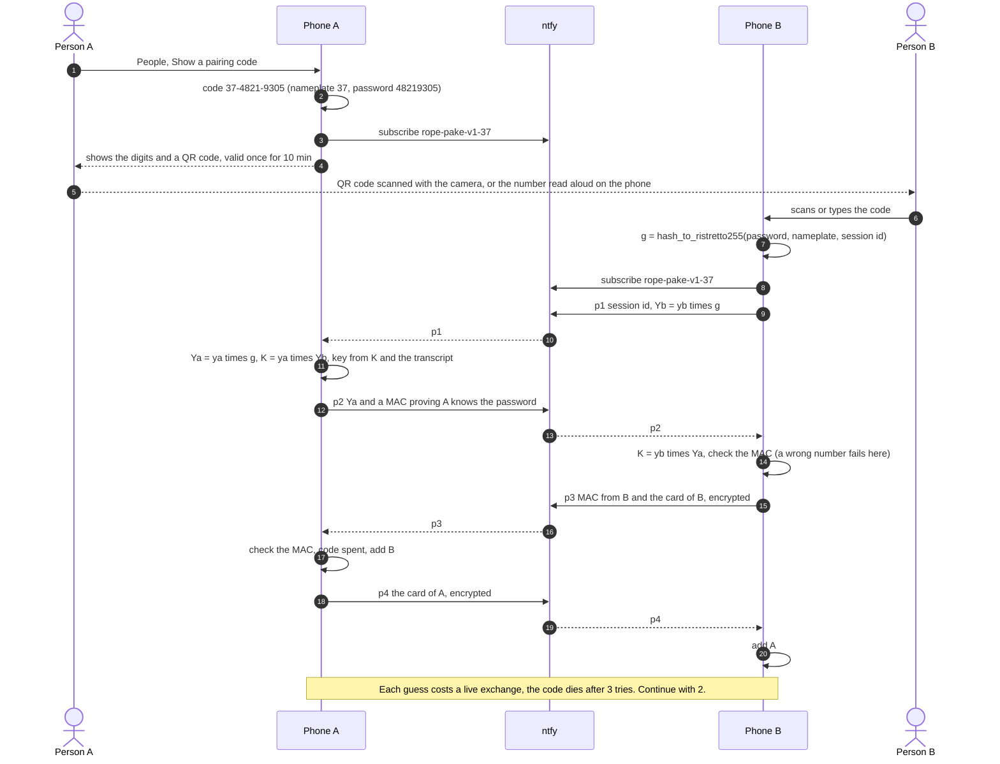
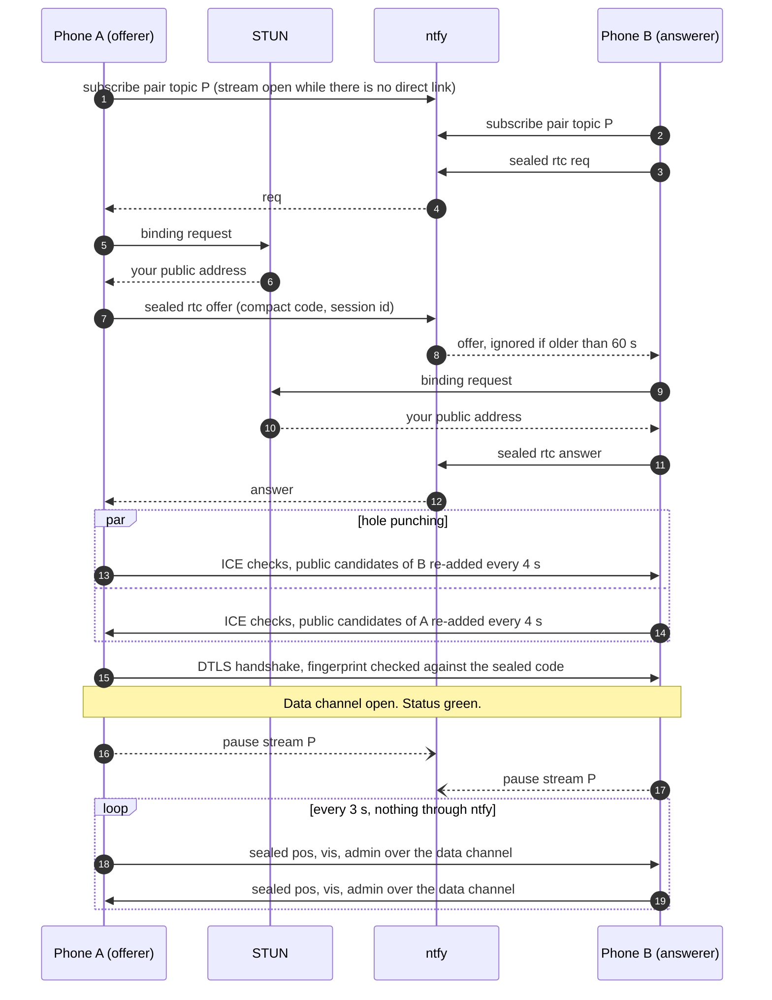
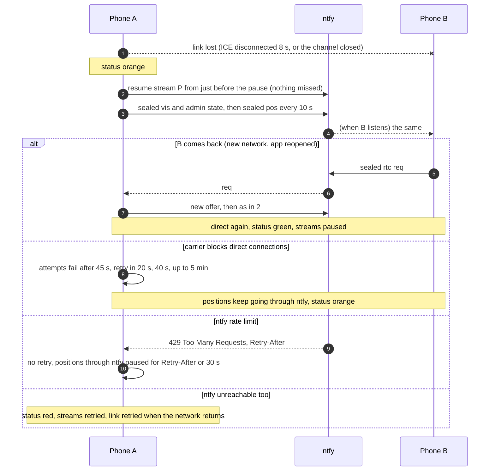
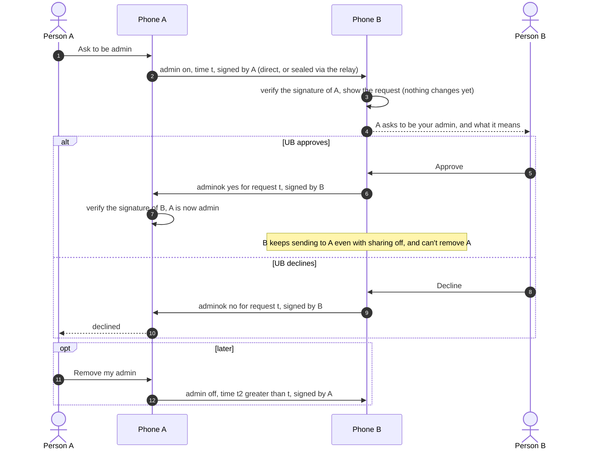

# Rope

A single-page web app with no backend of its own. It shows your GPS position on an
OpenStreetMap map, shares live positions with a circle of trusted people, shows the distance to
each of them in metres, adds terrain heights from hoydedata, and plans routes.

It is plain static files, so it runs on GitHub Pages.

```bash
npm start      # http://localhost:8080 (local static server)
npm test       # crypto, visibility/admin rules, distance
npm run build  # copies public/ to dist/
```

Browsers only give GPS and WebCrypto on `https://` or `localhost`.

## How people find each other without a backend

People can't connect directly without something to meet on. Rope uses a **rendezvous server**
(relay): a public [ntfy](https://ntfy.sh) publish/subscribe server (default `https://ntfy.sh`). It
is not ours and holds no accounts. Rope uses it **only to pair, and to (re)connect when there is
no direct link**. Everything it carries is either public values of the key exchange or ciphertext.
You can point Rope at your own ntfy server under **Me → Rendezvous server**. Everyone in a circle
must use the same one.

1. **Identity.** On first run your browser creates two keys (ECDH for the per-contact secret, ECDSA
   for signing admin requests and answers) and stores them in `localStorage`. Nothing is uploaded.
2. **Pairing with a number.** One person taps **People → Show a pairing code**. It shows a number
   like `37-4821-9305` and the same number as a QR code. The other person taps **Scan their code**
   and points the camera at the screen, or types the number, for example while they talk on the
   phone. The code works **once**, for **10 minutes**. Knowing it is the consent: both are contacts
   straight away.
   - The number is protected by a **PAKE** (password-authenticated key exchange), as in BeamBridge.
     Rope uses CPace on ristretto255 (`public/pake.js`, with the audited `@noble/curves`).
     The first 2 digits pick a meeting topic, and the other 8 are the password. Both phones turn the
     password into a secret point, exchange one random multiple of it each, and get the same key only
     if they used the same number. Each side then proves it holds the key (HMAC), and the contact
     cards (name and public keys) are exchanged encrypted with it.
   - The relay sees only those random points, proofs and ciphertext. Neither the relay nor anyone
     listening can learn the number or test guesses offline. Every guess needs a live exchange with
     the person showing the code, and the code is spent after **3 tries** or the first success.
     A wrong number is reported in a few seconds.
3. **Per-contact secret.** From the two identities, both phones derive the same secret (ECDH). It
   gives each contact an AES-GCM key and an unguessable topic of its own.
4. **Direct link (peer to peer).** The phones then open a direct WebRTC data channel, after
   OneChat's serverless connect. The offer and answer are packed into compact codes (ICE user and
   password, DTLS fingerprint, UDP candidates), sealed with the contact's key and sent over their
   topic. The other side rebuilds the SDP from a template. A public STUN server (Google, Cloudflare)
   tells each phone its public address, and the peer's public candidates are re-added every few
   seconds so both NATs keep their hole open until the checks meet. The side with the lower id
   always offers. The fingerprint arrives sealed with the contact's key, so only that contact can
   complete the handshake.
5. **While the direct link is open, the relay is not used at all.** Everything goes over the data
   channel: positions every 3 s, sharing on or off, and admin requests and answers. The contact's
   relay stream is paused, so the relay doesn't even see that you are online.
6. **When the direct link fails** (no signal, a new network, the app in the background, or a carrier
   that blocks direct connections), Rope falls back to the relay at once:
   - it reopens the contact's stream from where it was paused, so nothing is lost;
   - it sends your state through the relay (sealed);
   - it sends positions every 10 s;
   - it re-establishes the direct link through the relay with back-off (20 s doubling to 5 min, and
     at once when the network comes back or the app is reopened).

   When the link is back, the relay is paused again.
7. **Status symbol.** The dot at the top right shows the connection:
   - **green**: direct to everyone;
   - **orange**: at least one contact only via the relay;
   - **red**: no connection to at least one contact (offline, relay unreachable and no direct link);
   - **grey**: no contacts yet.

   Tap it for each contact's state. Each contact's line in People says *direct*, *via relay* or
   *no connection*.
8. **Rate limits.** ntfy.sh limits requests per IP address, and mobile carriers often put many
   phones behind one address. With direct links this matters little. Over the relay, a failed send
   is retried twice. A *429 Too Many Requests* is not retried, and position updates through the
   relay pause for as long as it asks (`Retry-After`).
9. **All messages between contacts** are sealed with AES-GCM and carry the sender's id (the relay
   echoes your own messages back to you) and a timestamp. A message older than 10 minutes, or not
   newer than the last one of its kind (remembered across reloads), is rejected, so the relay
   can't replay old messages.

## Following, trails and reload

- **Following:** the map opens following your own position. Two arrows sit at the bottom: the **left**
  one (your colour) follows you; the **right** one (the colour of the person) follows the person you chose
  with **Show**, and appears once you have chosen someone. An arrow is filled while it is following and
  outlined otherwise, and its glyph switches between white and black so it stays visible on any colour.
  Drag the map to stop following; each arrow then resumes its own target.
- **All:** the **All** entry in the top menu (next to Me) follows **you**, zoomed out just far enough that
  everyone you can see is in view, with you kept in the middle as you and they move. It also shows the
  trails of everyone who has one switched on. Dragging the map, or zooming it by hand, leaves All
  (zooming leaves you following yourself at the new zoom). Resizing the window or turning the phone keeps
  following whatever you were following.
- **Distances:** the measure-tape button (bottom right) toggles a live view of the direct distance from
  you to each person visible on the map: a dashed line in their colour with the distance at its middle,
  updating as either of you moves. It is **off by default** and the choice is remembered. Under 1 000 m
  it reads in whole metres (`850 m`); from 1 000 m it reads in kilometres (`1.25 km`, `12.3 km`, `152 km`).
  When a person is far away, the label sits on the part of the line that is on screen; if none of the
  line is on screen, the label is hidden.
- **Debug overlay:** tap **All** four times quickly (within 1.5 s) to show connection details over the
  map; four taps again, or ×, hide it. The choice is remembered on that device. It shows the build,
  network and GPS state; the rendezvous server (messages sent and failed, rate limits, each stream's
  state); per person the direct link (state, ICE, the route in use and its round-trip time, the next
  retry and the last error) and messages sent/received directly and via the server; and a log of
  recent events, warnings (yellow) and errors (red). **Copy** puts all of it on the clipboard, to
  paste into a bug report.
- **3D terrain:** the mountain button (bottom right, above the measure tape) shows the **ordinary map in
  3D**: the OpenStreetMap map is draped over the real terrain model from [hoydedata.no](https://hoydedata.no)
  (Kartverket), with a light hillshade, and the camera tilts to 60 degrees. It is **off by default** and the
  choice is remembered. Tilt further with two fingers (or right-drag with a mouse). Heights are drawn
  1.5 times taller than true, as is usual on maps. Kartverket is credited on the map while it is on.
  - *Where the heights come from:* no public service offers terrain tiles for the Norwegian model, so each
    tile is **made on the fly** from Kartverket's elevation service (WCS `wcs.hoyde-dtm-nhm-25833`,
    coverage `nhm_dtm_topo_25833`, a 1 m model, open to browsers): a 128 x 128 GeoTIFF of heights is
    fetched, decoded, resampled to the map's projection and written as a "Terrarium" height picture that
    the map library understands (`public/terrain.js`, `public/demprotocol.js`). Checked against real data:
    terrain shaded from these heights matched Kartverket's own hillshade picture with a correlation of
    0.93, and the heights the map uses equal the raw file's.
  - *Data use:* a tile is about 66 KB and takes about a second; a tilted view needs a dozen or two. Tiles
    are kept (nothing is asked for twice), at most 4 are in flight, and nothing is requested while it is off.
  - *Limits:* zoom 8 to 13 (below that, and where the service has no data, the ground is flat). A failed
    tile is retried once and asked for again later; a short outage does not flatten the ground for good.
    **All** shows everyone from above, so it lifts the tilt while the terrain stays on.
- **Offline map:** everything the map uses is saved on the device **as you use it**, by a service worker
  (`sw.js`): the app's own files, the MapLibre library, OpenStreetMap tiles, the 3D terrain tiles and the
  point heights. Nothing is downloaded ahead of time, so look at the area you will need while you have a
  network. Map tiles are refreshed in the background after 7 days, terrain after 90 days; each store is
  capped (about 5 000 map tiles, 1 200 terrain tiles) and drops its oldest entries.
  - **Go offline:** the cloud button above the 3D button (or the switch under **Me → Offline map**) makes the
    map use *only* saved parts and send no map requests. Unsaved places stay empty, with a short note
    instead of an error. The setting is remembered. With no network at all the app still starts from the
    saved copy, even without switching this on.
  - **Me → Offline map** shows how much is saved and has **Forget saved map**. Routing, point heights not yet
    seen, and the people relay still need a network. People's positions will not update while offline.
  - The app's files are fetched fresh when there is a network, so an update arrives at the next visit.
    Add it to the home screen for a full-screen app (a manifest and icon are included). iOS may clear
    saved data for sites not used for a while, so open the map again before a trip.
- **Scale:** a small scale line at the bottom left adapts as you zoom in and out.
- **Colour:** each person, you included, has one colour, used for their map marker, avatar, arrow and trail.
  Pick it from the palette (or leave it on Auto) in their card, or under Me for yourself. It is set
  independently of the trail switch.
- **Trails:** each person, you included, can have a trail of their last stretch of path, fading toward
  the oldest end. It is **off by default** and set per person: on/off, length (default 1 km)
  and the colour above. The **length** is chosen with two wheels, like an iOS picker: a number wheel and a unit wheel
  (**Metres, Kilometres, Miles**). Metres go from 50 to 950 in steps of 50, kilometres from 1 to 100 and miles
  from 1 to 60. A length is stored as you pick it, so 3 mi stays 3 mi. Turning the unit keeps the length as
  close as the new unit allows. The wheels curve away from the highlighted band (rows shrink, bunch together
  and fade), always come to rest exactly on a row, and work with touch (native momentum), a dragged mouse
  with momentum, the mouse wheel, a click on a row, and the arrow / page / home / end keys.
  A trail starts recording when you switch it on, lives only in memory on your device, and is
  removed if that person stops sharing. You can only trail people you are allowed to see.
- **Per person:** each person's row has their own trail switch and length (dimmed while the trail is off)
  and their colour, all usable before you switch the trail on. Tap a person on the map to jump to their
  row; tap your own blue dot for your settings.
- **Top bar:** a translucent bar that is always on one row: the **Rope** button, the menu (People, Route,
  Me, All) and a status dot. On a phone the status words appear briefly under the bar when something needs
  saying, and tapping the dot shows them again.
- **Reload:** tap the **Rope** button (top left) four times quickly to reload the app. A launch splash
  shows on a normal start; after a four-tap reload a shorter "Reloading" splash shows instead.

## Visibility and admin rights

- **Share my position** off: your client stops sending to everyone except your admins, and tells
  contacts you're hidden.
- **Admin needs the other person's approval.** *Ask to be admin* sends a request signed with your
  signing key. The other person sees it under People, with what it means: you will see them even
  when they turn sharing off, and they can't remove you until you give it up. Only if they tap
  **Approve** (an answer signed with *their* key, over your request) does it count. **Decline** tells
  you so. Until then your button reads *Admin asked · Cancel*, and nothing changes for them.
- Requests, answers and releases are stored and sent again until they arrive, so it works if the
  other phone is offline for a while. Each is verified against the sender's public signing key, and
  replayed or old ones are ignored.
- The admin can give it up at any time (*Remove my admin*). The subject sees who their admins are
  under Me.
- Grants made by earlier versions without approval are not trusted: on update, the subject is asked
  to approve them, and the admin's request is sent again.

### What this does and doesn't guarantee

With no server, the subject's own device decides what it sends. Rope makes the admin grant
unforgeable and sticky in the app, but **someone who modifies their client, clears their browser
data, or uses another device can stop sending**. Treat this as parental control among people who
use the app as intended, not as protection against a determined technical child. A tamper-proof
guarantee needs software the subject can't control, such as a managed device.

## Network flows

Who talks to whom. **A** and **B** are two phones running Rope; **ntfy** is the rendezvous server
(relay, `https://ntfy.sh` by default); **STUN** is a public STUN server (Google, Cloudflare).
GitHub renders these diagrams; elsewhere, paste them into [mermaid.live](https://mermaid.live).

### 1. Pairing with a number (QR code or read aloud), protected by a PAKE



### 2. Direct link: established through the relay, then the relay is left alone

The phone with the lower id makes offers; the other only asks. Offer and answer are compact codes
(ICE user and password, DTLS fingerprint, UDP candidates), sealed with the contact's key.



### 3. Fallback through the relay, and back to direct



### 4. Admin rights with consent



## Security assessment

An assessment of the current code, as a reviewer would write it. Severity reflects impact on the
people using Rope. The **Status** column says what this version did about each finding.

### What is protected, and how

| Asset | Protection |
|---|---|
| First contact (pairing) | A 10-digit one-time code, exchanged by QR code (screen to camera) or read aloud, protected by a PAKE (CPace on ristretto255, `@noble/curves`). There are no offline guesses; each online guess needs the other phone, and the code dies after 3 tries, the first success or 10 minutes. Explicit key confirmation (HMAC) both ways. Cards are encrypted with the PAKE key. |
| Positions, visibility, admin messages | AES-256-GCM with a per-contact key (static ECDH P-256 plus HKDF), on the direct link and on the relay. Sender id and timestamp; replays and old messages are rejected, also after a reload. |
| Direct link | WebRTC DTLS (ephemeral keys); the DTLS fingerprint and ICE credentials are exchanged sealed with the per-contact key, so nobody in the middle can complete the handshake. |
| Use of the relay | Only for pairing and while there is no direct link. With a direct link, the contact's relay stream is closed. |
| Admin rights | Request signed by the would-be admin; rights only after the subject's signed approval of that very request. |
| Page | Content-Security-Policy; all user-supplied text escaped; no third-party code for pairing or crypto (vendored, pinned, built from npm by `npm run vendor`). |

### Findings

| # | Severity | Finding | Status / recommendation |
|---|---|---|---|
| 1 | High | **Admin rights could be taken without consent.** | **Fixed.** Admin needs the subject's signed approval. Old unapproved grants must be approved again. |
| 2 | **High** | **Private keys share an origin with other sites.** GitHub Pages serves every project of the account as `joranlager.github.io/<repo>/`, one origin. `localStorage` (and the CSP's `'self'`) is per origin, so any page on that origin can read Rope's private keys and contacts. | **Open.** Serve Rope from its own origin (a custom domain or a dedicated account). Store keys as non-extractable `CryptoKey`s in IndexedDB. |
| 3 | Medium | **Third-party map script without integrity check.** MapLibre comes from unpkg with no SRI hash, and the CSP allows all of `https://unpkg.com`. | **Open.** Vendor MapLibre like the other libraries, and drop unpkg from the CSP. (The pairing and QR libraries are already vendored.) |
| 4 | Medium | **No forward secrecy on relay messages.** The per-contact key is static. Anyone who later gets a private key can decrypt relay traffic recorded earlier (ntfy keeps it for hours). | **Reduced.** With a direct link nothing goes through the relay, and DTLS on the link has forward secrecy. Open for relay fallback: add an ephemeral key exchange per session. |
| 5 | Medium | **Location sent to third parties.** Hoydedata (Kartverket) gets your coordinates for terrain height; OSRM gets route ends; the OpenStreetMap tile server sees the area you view. | **Open.** Make terrain height optional or coarse; consider a proxy or self-hosting. |
| 6 | Medium | **Relay metadata.** | **Reduced.** The plaintext invite handshake and inbox are gone (pairing goes through the PAKE). With a direct link, the relay doesn't see you at all. Remaining: during pairing and fallback the relay sees IPs, timing and the per-pair topic. Self-host ntfy if this matters. |
| 7 | Low-Medium | **A direct link reveals your public IP to the contact** (and to the STUN servers), even when you hide from them. | **Open.** Option: no direct link to contacts you hide from, or a "relay only" setting. |
| 8 | Low | **Replay of old messages by the relay.** | **Fixed.** All messages carry a timestamp; older than 10 min, or not newer than the last of their kind (kept across reloads), is rejected. |
| 9 | Low | **Reusable invite link** anyone could use to send requests. | **Fixed.** The invite link is removed; the only way to pair is a one-time code. |
| 10 | Low | **Pairing code without PAKE** (offline brute force against the derived topic). | **Fixed.** Replaced by CPace. Note: with a 2-digit nameplate, two people pairing at the same moment can meet on the same topic. The PAKE keeps them apart (wrong proofs are ignored), but a stranger's join attempt counts against your 3 tries. |
| 11 | Low | **The debug log can contain IP addresses** (the route of a direct link) and names; *Copy* puts them on the clipboard. | **Open.** Mask addresses unless asked. |
| 12 | Low | **A spoken or shown code can be overheard or seen.** Whoever enters it first, within 10 minutes, is paired. | **By design**, as in BeamBridge. Read the code only to the person you mean and check that both phones say *Paired with* the right name. |
| 13 | Info | **Visibility is enforced by the sender's own app** (see [What this does and doesn't guarantee](#what-this-does-and-doesnt-guarantee)). | By design. |
| 14 | Info | **Backup contains private keys in plain text.** | **Open.** Encrypt the backup with a passphrase. |

**Fixed in earlier work:**
- The relay echoed your own messages back, and they were taken as the contact's. A sender id now prevents it.
- Rate-limit storms were made worse by retries. A 429 is no longer retried.

**Not covered:** no penetration test, no audit of the bundled libraries (they are widely used and,
for `@noble/curves`, independently audited), and no testing on real devices or carrier networks.
The CPace construction follows the CFRG draft in structure (generator from the password and
session id, ephemeral shares, transcript-bound key, explicit confirmation) but is not a byte-exact
implementation of it.

## Limits and things to verify

- **Not yet exercised against live services.** The build environment couldn't reach ntfy.sh,
  OpenStreetMap, Geonorge or the CDN. These need a check in a real browser: ntfy's `/sse` endpoint
  and CORS, the hoydedata response shape (`punkter[0].z`) and CORS, and the OSRM responses.
- The base map uses the public OpenStreetMap tile server, which is meant for light use under its
  [tile usage policy](https://operations.osmfoundation.org/policies/tiles/). For heavier use,
  switch to a tile provider or your own tile server.
- Public ntfy.sh is rate limited and keeps messages only for a limited time. Use your own server
  for regular use.
- Routing uses the OSRM demo server (car only). Walk and bike need a different routing service.
- Your private keys live only in this browser. Use **Me → Copy backup** and keep it secret.
- No SRI hashes on the MapLibre CDN tags yet (see finding 3).

## Layout

```
public/index.html  the single page (with a Content-Security-Policy meta tag)
public/app.js      UI, GPS, contacts, handshake, messaging, routing
public/crypto.js   identity keys, cards, ECDH/HKDF, AES-GCM, signatures
public/net.js      ntfy publish/subscribe
public/p2p.js      direct WebRTC link per contact: compact offer/answer codes, hole punching
public/pake.js     pairing with a number: CPace PAKE over the relay
public/vendor/     bundled libraries (@noble/curves, jsQR, qrcode-generator), built by npm run vendor
public/debug.js    debug overlay and its event log (four taps on All)
public/social.js   pure visibility and admin rules (unit tested)
public/geo.js      haversine, elevation helpers
public/distance.js distance labels and where to place them on screen (pure, tested)
public/terrain.js  3D terrain: tiles, GeoTIFF decoding, resampling, Terrarium encoding (pure, tested)
public/demprotocol.js  makes the terrain tiles on demand for the map library
public/sw.js       service worker: saves the app and the map parts as they are used (unit tested)
public/offline.js  page side of offline maps: register, offline mode, what is saved
public/manifest.webmanifest  + icons/  makes the app installable
public/follow.js   what the map is following: me, a person, or all (pure, tested)
public/colors.js   one colour per person and a visible glyph colour (pure, tested)
public/trace.js    trails: trimming, jitter, colours, the wheel model (pure, tested)
public/wheel.js    the two-wheel number + unit picker
public/boot.js     picks the splash before first paint
```

Every branch builds with `.github/workflows/pages.yml` and deploys to GitHub Pages. All branches
share one site, so the latest deploy wins.
